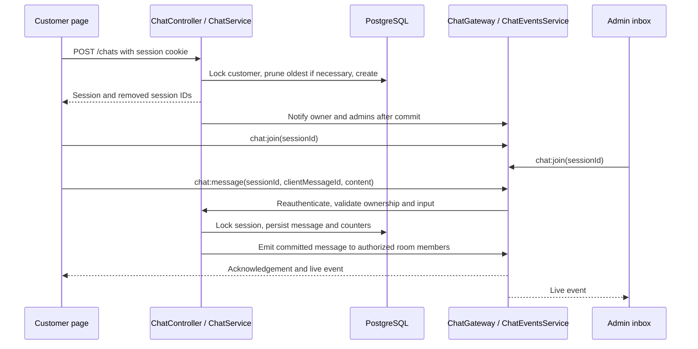
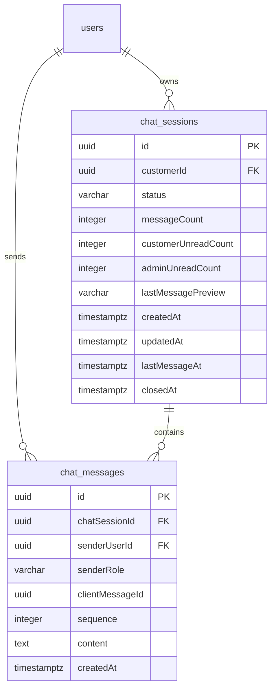

# Customer and admin live chat

Version 1 adds text-only human support chat, independently of the AI product assistant. Customers use `/support/chat`; administrators use `/admin/chats`. Repairers cannot access the chat REST endpoints or namespace.

## Runtime and authentication

The existing NestJS process serves REST and Socket.IO namespace `/chat` on the same port, using the default `/socket.io` transport path. The React client uses the shared API base URL's origin and sends cookies. No new environment variables or external services are required. `FRONTEND_URL` must match the browser origin exactly, including scheme and port. A production reverse proxy must forward Socket.IO HTTP polling and WebSocket upgrades.

The application currently authenticates with opaque HttpOnly cookie sessions, despite the retained `JwtAuthGuard` name. Chat reuses this authentication rather than adding a separate JWT system. Connection middleware validates origin, cookie, active account and CUSTOMER/ADMIN role. Every socket operation reauthenticates; message recipients are reauthenticated before delivery as well. Client-supplied identities and roles are never trusted.

## Component interactions

`ChatService` owns business rules and transactions. `ChatGateway` validates typed event payloads and authentication. `ChatEventsService` delivers committed events to authorized room members. The frontend shares typed REST/socket services, a `useSupportChat` hook, and conversation/list components between separate customer and admin pages. Messages render as plain React text.

## Persistence and limits

Migration: `src/database/migrations/1792310000000-CreateLiveChat.ts`. Apply with `npm run migration:run -- -d src/database/data-source.ts`. Schema synchronization remains disabled.

- Each customer keeps at most five sessions. Session creation locks that customer's user row; concurrent creation serializes. Creating a sixth deletes the oldest by creation time and ID, with messages cascading in the same transaction. Other customers' sessions are untouched.
- Each session accepts at most 100 total customer and admin messages. Sending locks the session, checks actual persisted count, inserts the next sequence and updates counters/status in one transaction. Message 100 closes the session. A database sequence check of 1–100 and unique `(chatSessionId, sequence)` also prevent more than 100 rows.
- Text is trimmed and must contain 1–2,000 characters. Unknown fields, attachments and malformed identifiers are rejected. Socket transport payloads are capped at 16 KB.
- Unique `(chatSessionId, senderUserId, clientMessageId)` makes retries idempotent. An identical retry returns the existing delivery even after closure; reusing the ID with different text returns conflict. A new message in a closed chat is rejected.
- Histories return at most 100 messages chronologically, with a sequence tie-breaker. Customer/date and status/activity indexes support inbox reads. Foreign keys cascade user/session deletion to chat data.
- Admin unread counts describe the shared support team, not individual administrators. Joining/reading clears the relevant role's unread count.

## REST contract

All routes use existing cookie and role guards. Customer detail/history routes additionally enforce ownership. UUID parameters are validated. Lists accept optional `status=OPEN|CLOSED`, `page` (default 1), and `limit` (default 25, maximum 50).

| Method and path | Access | Result |
| --- | --- | --- |
| `POST /chats` | CUSTOMER | `{ session, removedSessionIds }`; empty body |
| `GET /chats` | CUSTOMER | Own paginated sessions |
| `GET /chats/:id` | CUSTOMER owner | Session |
| `GET /chats/:id/messages` | CUSTOMER owner | Chronological message array |
| `GET /admin/chats` | ADMIN | Paginated sessions with safe customer name/email |
| `GET /admin/chats/:id` | ADMIN | Session with customer details |
| `GET /admin/chats/:id/messages` | ADMIN | Chronological message array |
| `PATCH /admin/chats/:id/close` | ADMIN | Closed session; repeated close is accepted |

Messages are sent through Socket.IO, not a separate REST mutation. Browser REST mutations retain the existing origin/header checks.

## Socket contract

Connect to `/chat` with credentials from the allowed frontend origin. Each client joins its authorized notification room; joining a conversation switches its active room to `chat:<sessionId>`. Clients cannot choose arbitrary notification rooms.

| Client event | Payload | Acknowledgement data |
| --- | --- | --- |
| `chat:join` | `{ sessionId }` | Session, marked read |
| `chat:leave` | `{ sessionId }` | `null` |
| `chat:read` | `{ sessionId }` | Session, marked read |
| `chat:message` | `{ sessionId, clientMessageId, content }` | `{ session, message }` |

Acknowledgements are `{ ok: true, data }` or `{ ok: false, error: { statusCode, message } }`. Validation/auth/ownership/closed-chat failures use safe errors; no stack traces, tokens or message bodies are logged.

Server events: `chat:message:new` carries `{ session, message }` only to authorized conversation members; `chat:session:created` and `chat:session:updated` carry `{ sessionId }` to the owner and admins to refresh lists; `chat:session:closed` and `chat:limit:reached` carry the session to its conversation; `chat:session:removed` carries `{ sessionId }`; `chat:error` carries `{ statusCode, message }`.

## Frontend behavior

Pages handle loading, empty, error and success states, closed/limit notices, connection status, safe retry and reconnection. The customer page explains the five-session retention rule. The admin inbox supports status filtering, pagination, customer identity, previews, activity, unread counts and closing a session. Navigation is role-specific.

The hook joins before fetching a history snapshot and merges messages by persisted ID/sequence, avoiding duplicate rendering from acknowledgements and live events. Reconnection rejoins the selected conversation and refreshes history. Switching sessions leaves the old room. Unmount removes listeners and disconnects sockets. The composer disables concurrent submissions, sends client-generated UUIDs and provides retry after an unconfirmed acknowledgement.

## Validation and operational scope

- Backend: `npm run test:chat:integration` runs 45 checks using actual Nest HTTP, cookie sessions, Socket.IO and PostgreSQL, including privacy, spoofed identities, role denial, retention, concurrent creation/sending, idempotency, closure and revoked recipients.
- Frontend: `npm run test:chat:e2e` uses separate authenticated customer/admin browser contexts on desktop and mobile, exercises live messages both ways, persisted history and live closure. Test email is mocked; no SMTP is sent.
- Builds: `npm run build` in each project. Integration tests require the migrated local PostgreSQL database and remove their fixtures afterward.

Version 1 assumes a single backend instance for live socket delivery. Database locking protects persistence across processes, but live rooms do not span processes without a shared adapter. There are no attachments, typing indicators, delivery receipts, repairer chat, AI replies, external brokers or background jobs. Retention is intentionally destructive: creating session six permanently removes the oldest session and history. No time-based archival or chat email notifications are implemented.
